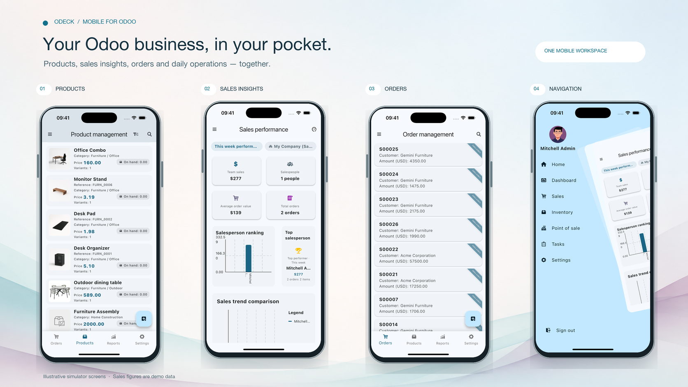

# Odeck Bridge

Odeck Bridge is a free, optional Odoo addon that lets the Odeck mobile POS client use Odoo's standard pricelist and tax engines. Choose the branch matching your Odoo version, then copy the `odeck_bridge` folder into your addons path.

[Installation and technical documentation](odeck_bridge/README.md) · [简体中文](odeck_bridge/README.zh_CN.md) · [License](odeck_bridge/LICENSE.md)

## Odeck Mobile

Odeck Mobile connects to your own Odoo server and provides a mobile view for products, sales orders, inventory, sales performance, and POS workflows. Odeck Bridge is only required for server-side POS pricelist and tax calculations; ordinary login, browsing, and order viewing use Odoo's standard APIs.

The banner above is a generated product illustration. The feature overview below is a custom composition made from original app simulator captures; every phone uses the same frame and scale. Sales figures are illustrative demo data, not live customer data.

## Android APK downloads

When a signed Android release is available, download the APK from [GitHub Releases](https://github.com/liuv/odeck-bridge/releases). The APK is distributed as a release asset rather than inside the Odoo addon. Check the release notes for the app version, supported Odoo versions, and SHA-256 checksum.

Android updates must keep the same signing identity as the installed app. Development/debug builds are not suitable as update packages. Odeck Bridge does not download or install the APK; users install the mobile client separately.

## Branches

- `17.0` — Odoo 17
- `18.0` — Odoo 18
- `19.0` — Odoo 19
- `20.0` — Odoo 20

See the [addon documentation](odeck_bridge/README.md) for requirements, installation, and POS endpoint details.
